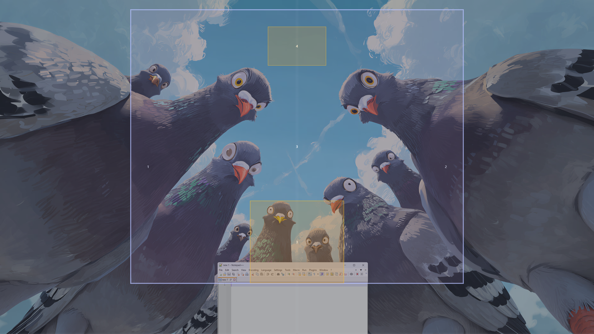

<div align="center">
  
  <h1>ZoneSnap</h1>
  <p>
    <strong>Lightweight, single-binary portable window snapping and window management for Windows 10 &amp; 11 — written in Rust.</strong>
  </p>

  <p>
    <a href="https://github.com/PlatyLord/zonesnap-rs/releases">
      
    </a>
    <a href="LICENSE">
      
    </a>
    
    
    
  </p>

  <p>
    <a href="#why-zonesnap">Why ZoneSnap?</a> &middot;
    <a href="#screenshots">Screenshots</a> &middot;
    <a href="#quick-start">Quick Start</a> &middot;
    <a href="#controls--shortcuts">Controls</a> &middot;
    <a href="#zonesjson-configuration-reference">Configuration</a> &middot;
    <a href="#building-from-source">Building</a>
  </p>

  <br />

  
  <p>
    <em>ZoneSnap overlay showing decoupled amber <strong>Custom Trigger Areas</strong> inside wider side-column snap targets.</em>
  </p>
</div>

> **Status & License:** Released as-is under the [GNU General Public License v3.0 (GPL-3.0)](LICENSE). This project is not actively maintained—forks and community improvements are welcome, provided derivative works remain open source under GPL-3.0.

---

## Why ZoneSnap?

- **True Single-File Portability:** One standalone `zonesnap.exe` (~3.2 MB) with zero installer, zero external DLLs, zero `%APPDATA%` clutter, and zero Windows Registry entries. All settings live in `zones.json` directly beside the executable.
- **~1–3 MB Idle Memory Footprint:** The daemon sits near ~1 MB at startup, keeps overlay buffers cached during active dragging for smooth responsiveness on 1440p and 4K displays, and automatically evicts full-screen overlay surfaces after 10 seconds of idle time.
- **Mixed-DPI & Multi-Monitor Accurate:** Runs in `PerMonitorV2` DPI mode and tracks each monitor's `rcWork` work area (excluding taskbars) keyed by display name and resolution.
- **Two Snapping Modes, Unlimited Layouts:** Switch on the fly between **Dynamic Grid** (WindowGrid-style drag-to-span cells) and **Custom Zones** (FancyZones-style normalized rectangles with decoupled **Custom Trigger Areas**, `Shift` merging, and shared-border merging).
- **Effortless Alt-Window Manipulation:** Move any window from anywhere inside it (`Alt + Left-Drag`), drag to the top of any monitor to maximize, or resize from the nearest edge or corner (`Alt + Right-Drag`) without hunting for thin window borders.
- **Ctrl Monitor-Lock (`ClipCursor`):** Hold `Ctrl` while dragging to lock the cursor inside the active monitor so you never accidentally overshoot onto an adjacent screen when snapping at a shared edge.
- **100% Flush DWM Snapping & Unsnap Restore:** Automatically compensates for Windows 10/11 invisible drop-shadow borders (`DWMWA_EXTENDED_FRAME_BOUNDS`) so windows sit completely flush, and restores a snapped window's original size when dragged away.
- **Themed Visual Editor & System Tray:** Quick-switch layouts per monitor right from the system tray, or open the on-demand `egui` editor with **10 built-in Light, Dark & Catppuccin themes** and DPI-friendly scaling.

---

## Screenshots

<table>
  <tr>
    <td width="50%" align="center">
      <br />
      <strong>Custom Zones &amp; Trigger Area Editor</strong><br />
      <sub>Draw/resize snap bounds (blue) and compact drop triggers (amber).</sub>
    </td>
    <td width="50%" align="center">
      <br />
      <strong>Dynamic Grid Editor</strong><br />
      <sub>Configure per-monitor grids from 2&times;2 up to 24&times;16 with live preview.</sub>
    </td>
  </tr>
  <tr>
    <td width="50%" align="center">
      <br />
      <strong>Shortcuts &amp; Modifiers</strong><br />
      <sub>Customize hotkeys and drag modifiers alongside a live 14-row reference.</sub>
    </td>
    <td width="50%" align="center">
      <br />
      <strong>Themes, Scaling &amp; Behavior</strong><br />
      <sub>Light, Dark, and Catppuccin Mocha/Macchiato/Frappé/Latte themes plus text scaling.</sub>
    </td>
  </tr>
</table>

---

## Quick Start

1. **Download:** Grab `zonesnap.exe` (and optionally `SHA256SUMS.txt`) from the [Releases](https://github.com/PlatyLord/zonesnap-rs/releases) page.
2. **Run Anywhere:** Place `zonesnap.exe` in a folder of your choice (for example `C:\Tools\ZoneSnap\` or a USB stick) and double-click it.
   - No console window opens; ZoneSnap sits quietly in your Windows system tray.
   - On first run, it automatically creates `zones.json` in the same folder with starter layouts for every connected monitor.
3. **Start Snapping:**
   - Drag any window by its title bar and tap **Right-Click** (without releasing Left-Click) to pop up the zone overlay, move across zones, and release **Left-Click** to snap.
   - Or press **`Win + Alt + Z`** to snap the currently focused window with keyboard + click.

> **Tip:** Right-click the ZoneSnap tray icon anytime to switch active layouts per monitor, open **Configure Zones & Settings**, reload `zones.json`, or exit.

---

## How It Works (Workflows)

### 1. Standard Drag + Seamless Zone Overlay

1. Left-click and drag a window by its title bar as usual.
2. Tap **Right-Click** while still holding **Left-Click** — ZoneSnap suppresses the title-bar context menu and opens the translucent zone overlay on whichever monitor the cursor is currently on.
3. Release **Left-Click** to snap the window flush into the highlighted zone(s).
4. Want to cancel and drop the window freely instead? Press **`Esc`** or tap **Right-Click** a second time.

### 2. Alt Move & Resize (Drag Anywhere Inside a Window)

- **Move (`Alt + Left-Drag`):** Hold `Alt` and left-drag from _anywhere_ inside a window to move it smoothly. Tap **Right-Click** mid-drag to hand off directly to the zone overlay, or drag the cursor to the top edge of any monitor to preview and **Maximize** on release (`drag_top_maximize`).
- **Resize (`Alt + Right-Drag`):** Hold `Alt` and right-drag anywhere inside a window. ZoneSnap divides the window into a 3×3 grid and resizes smoothly from the nearest edge or corner.
- **Nearest-Corner Resize (`Alt + Shift + Right-Drag`):** Hold `Alt + Shift` (configurable via `corner_resize_modifier`) and right-drag anywhere inside a window to always grab and resize from the nearest corner (2×2 quadrants), even if your cursor starts near the center or middle of an edge.

### 3. Dynamic Grid vs. Custom Zones

- **Dynamic Grid (`cols × rows`, default `12 × 6`):** The cell under your cursor when the overlay opens becomes the anchor cell. Moving the mouse spans a rectangle from the anchor cell to your current cell, displaying the live span size (e.g. `6 × 3`).
- **Custom Zones:** Displays your defined zone rectangles (`1`, `2`, `3`, ...).
  - **Custom Trigger Areas (Decoupled Drop Target vs. Snap Size):** Any custom zone can define a compact **Trigger** box separate from its full **Snap Output** bounds. For example, place a small Center Focus drop pad (`trigger`) in the middle of the screen over Left/Right side columns (`bounds`), so dragging near the center-left or center-right still cleanly hits the side columns while dropping onto the center pad snaps to the full centered focus window.
  - **Shared-Border Merge:** Move your cursor within `16px` of a shared border between adjacent standard zones to automatically merge them into their combined bounding box.
  - **Multi-Zone `Shift` Merge:** Hold **`Shift`** and sweep across multiple zones to merge all of them together.

### 4. Scroll-Wheel Layout Cycling & Monitor Lock

- **Cycle Layouts (`Mouse Wheel`):** While the zone overlay is visible, scroll up or down to cycle through all saved layouts for that monitor. A floating toast pill displays the newly active layout's name and saves your selection.
- **Monitor-Lock (`Hold Ctrl`):** Hold `Ctrl` during any window move or zone drag to clamp the cursor inside the active monitor's physical bounds (`ClipCursor`). Releasing `Ctrl` or finishing the drag immediately unlocks the cursor.

### 5. Unsnap Size Restoration

When a window is snapped by ZoneSnap, its pre-snap position and size are cached in memory (with periodic cleanup of closed windows). If you later drag that window away without triggering another zone snap, ZoneSnap automatically restores its original width and height centered under your cursor.

---

## Controls & Shortcuts

| Action                              | Default Input                              | Notes                                                           |
| ----------------------------------- | ------------------------------------------ | --------------------------------------------------------------- |
| **Trigger Overlay During Drag**     | Drag title bar + tap `Right-Click`         | Suppresses context menu; release `Left-Click` to snap           |
| **Move Window Anywhere**            | `Alt + Left-Drag`                          | Configurable move/resize modifier                               |
| **Drag-to-Top Maximize**            | `Alt + Left-Drag` to monitor top edge      | Shows Maximize preview; release `Left-Click` to maximize        |
| **Hand Off Alt-Move to Zones**      | Tap `Right-Click` during `Alt + Left-Drag` | Opens zone overlay mid-drag                                     |
| **Resize from Nearest Edge/Corner** | `Alt + Right-Drag`                         | 3×3 window region detection                                     |
| **Resize from Nearest Corner Only** | `Alt + Shift + Right-Drag`                 | 2×2 quadrant detection (configurable `corner_resize_modifier`)  |
| **Lock Cursor to Active Monitor**   | Hold `Ctrl` while dragging                 | Configurable monitor-lock modifier                              |
| **Cycle Layouts on Monitor**        | `Mouse Wheel` (overlay active)             | Updates layout live with toast badge                            |
| **Merge Custom Zones**              | Hold `Shift` or hover border (`±16px`)     | Combines hovered zones into bounding box                        |
| **Cancel Overlay**                  | `Esc` or 2nd `Right-Click`                 | Dismisses overlay without snapping                              |
| **Keyboard Overlay Trigger**        | `Win + Alt + Z`                            | Opens overlay for focused window; `Left-Click` snaps            |
| **Open Settings & Zone Editor**     | `Win + Alt + E` or Tray Menu               | Launches visual editor (`--settings`)                           |
| **Save in Settings Editor**         | `Ctrl + S` or **Save & Apply**             | Writes `zones.json` and hot-reloads daemon                      |

---

## System Tray & Visual Zone Editor

- **System Tray Menu:** Right-click the ZoneSnap icon in the notification area to:
  - **Switch Layout:** One-click switching between saved layouts for each connected monitor.
  - **Configure Zones & Settings:** Opens the visual editor (also opens on tray double-click).
  - **Reload zones.json:** Manually reloads configuration from disk (also happens automatically on file change).
  - **Exit:** Cleanly unhooks input listeners, removes the tray icon, and exits.
- **Visual Zone Editor (`Layouts & Visual Zone Editor` tab):**
  - Pick any connected or saved monitor profile.
  - Select a layout to edit and activate it, **+ Add Layout**, **Duplicate** an existing layout, **Copy to Monitor...** (great for mixed-resolution setups), or **Delete Layout**.
  - Switch between **Dynamic Grid** (adjusting columns `2–24` and rows `2–16`) and **Custom Zones** (drag empty space to draw zones, drag to move, drag 8 corner/edge handles to resize, enable **Custom Trigger Area** to decouple amber trigger pads from blue snap bounds, **Split V/H**, apply **2 Cols / 3 Cols / 2×2 / Focus+Stack / Center Focus + Sides** presets, or fine-tune normalized coordinates).
- **Shortcuts & Modifiers tab:** Rebind `Win + Alt + Z`, `Win + Alt + E`, the Move/Resize modifier, Monitor-Lock modifier, and Nearest-Corner Resize modifier, plus view the live **Complete Controls & Shortcuts Reference**.
- **Appearance & Behavior tab:** Choose from **10 Light/Dark/Catppuccin themes** (`Dark`, `Light`, `Catppuccin Mocha/Macchiato/Frappé/Latte`, `Nord`, `Tokyo Night`, `Gruvbox Dark`, `Solarized Light`), click **Match Overlay Colors** to pair the overlay palette with your theme, adjust **Settings Window Text Scale** (`85%–175%`, or `Ctrl +`/`-`/`0`), customize highlight/border colors and opacities, toggle unsnap size restoration and drag-to-top maximize, and manage the `excluded_apps` process blacklist.

---

## Multi-Monitor & Mixed-DPI Notes

- Each monitor profile in `zones.json` is keyed by `<device_name>_<width>x<height>` (for example `\\.\DISPLAY1_2560x1440`) and snaps inside `rcWork` so the Windows taskbar is never covered.
- When snapping a window across monitors with different DPI scaling factors, ZoneSnap performs a second-pass `DWMWA_EXTENDED_FRAME_BOUNDS` measurement after moving to the target monitor so edges remain flush.

---

## `zones.json` Configuration Reference

`zones.json` is stored in the exact same directory as `zonesnap.exe`.

<details>
<summary>View example <code>zones.json</code></summary>

```json
{
  "version": 1,
  "appearance": {
    "highlight_color": [56, 189, 248],
    "highlight_opacity": 0.35,
    "border_color": [56, 189, 248],
    "zone_bg_opacity": 0.14,
    "gui_scale": 1.0,
    "gui_theme": "dark"
  },
  "behavior": {
    "restore_on_unsnap": true,
    "drag_top_maximize": true,
    "excluded_apps": ["mstsc.exe", "vmconnect.exe"]
  },
  "hotkeys": {
    "activate_overlay": { "modifiers": ["Win", "Alt"], "key": "Z" },
    "open_settings": { "modifiers": ["Win", "Alt"], "key": "E" },
    "move_resize_modifier": "Alt",
    "monitor_lock_modifier": "Ctrl",
    "corner_resize_modifier": "Shift"
  },
  "monitors": {
    "\\\\.\\DISPLAY1_2560x1440": {
      "device_name": "\\\\.\\DISPLAY1",
      "width": 2560,
      "height": 1440,
      "active_layout_index": 0,
      "layouts": [
        {
          "name": "Dynamic Grid (12x6)",
          "mode": { "type": "dynamic_grid", "cols": 12, "rows": 6 }
        },
        {
          "name": "Columns (3-Up)",
          "mode": {
            "type": "custom_zones",
            "zones": [
              [0.0, 0.0, 0.5, 1.0],
              [0.5, 0.0, 1.0, 1.0],
              {
                "bounds": [0.15, 0.0, 0.85, 1.0],
                "trigger": [0.42, 0.25, 0.58, 0.75]
              }
            ]
          }
        }
      ]
    }
  }
}
```

</details>

### Field Reference

| Section      | Field                    | Default                          | Description                                                                                                                            |
| ------------ | ------------------------ | -------------------------------- | -------------------------------------------------------------------------------------------------------------------------------------- |
| `appearance` | `highlight_color`        | `[56, 189, 248]`                 | RGB fill color of active/hovered zones                                                                                                 |
| `appearance` | `highlight_opacity`      | `0.35`                           | Opacity of active zone fill (`0.05`–`0.85`)                                                                                            |
| `appearance` | `border_color`           | `[56, 189, 248]`                 | RGB border color of active zone outline                                                                                                |
| `appearance` | `zone_bg_opacity`        | `0.14`                           | Opacity of inactive custom zone cards (`0.0`–`0.50`)                                                                                   |
| `appearance` | `gui_scale`              | `1.0`                            | Settings GUI text/UI scale multiplier (`0.85`–`1.75`, on top of Windows DPI scaling)                                                   |
| `appearance` | `gui_theme`              | `"dark"`                         | Settings GUI theme (`dark`, `light`, `catppuccin_mocha`/`macchiato`/`frappe`/`latte`, `nord`, `tokyo_night`, `gruvbox_dark`, `solarized_light`) |
| `behavior`   | `restore_on_unsnap`      | `true`                           | Restore original window size when dragged away                                                                                         |
| `behavior`   | `drag_top_maximize`      | `true`                           | Maximize window when `Alt + Left-Drag` reaches the top edge of a monitor                                                               |
| `behavior`   | `excluded_apps`          | `["mstsc.exe", "vmconnect.exe"]` | Lowercase executable names where mouse hooks pass through untouched                                                                    |
| `hotkeys`    | `activate_overlay`       | `Win+Alt+Z`                      | Global hotkey to open overlay for focused window                                                                                       |
| `hotkeys`    | `open_settings`          | `Win+Alt+E`                      | Global hotkey to open Settings & Zone Editor                                                                                           |
| `hotkeys`    | `move_resize_modifier`   | `"Alt"`                          | Modifier for Alt-move & Alt-resize (`Alt`, `Ctrl`, `Shift`, `Win`)                                                                     |
| `hotkeys`    | `monitor_lock_modifier`  | `"Ctrl"`                         | Modifier to clamp cursor to monitor (`Ctrl`, `Shift`, `Alt`, `Win`)                                                                    |
| `hotkeys`    | `corner_resize_modifier` | `"Shift"`                        | Extra modifier held during `Alt + Right-Drag` to force nearest-corner resize (`Shift`, `Ctrl`, `Alt`, `Win`, `Disabled`)               |
| `monitors`   | `active_layout_index`    | `0`                              | 0-based index of the active layout for that monitor                                                                                    |
| `monitors`   | `layouts`                | 3 starter layouts                | List of `dynamic_grid` (`cols`, `rows`) or `custom_zones` (`[x1, y1, x2, y2]` or `{ bounds, trigger }`)                                |

Supported hotkey `key` values: `A`–`Z`, `0`–`9`, `F1`–`F12`, `Space`, `Tab`, `Enter`, `Escape`, `Left`, `Right`, `Up`, `Down`.

---

## Troubleshooting & FAQ

- **An elevated (Run as Administrator) window won't snap or move:** Windows UIPI blocks non-elevated hooks/processes from moving elevated windows. ZoneSnap fails silently by design; if you need to manage elevated windows, run `zonesnap.exe` as Administrator.
- **Remote Desktop or a fullscreen game intercepts Alt-clicks:** Add its process filename (e.g. `mstsc.exe`, `game.exe`) under **Appearance & Behavior → Excluded Applications** (`excluded_apps`).
- **Windows SmartScreen warns on an unsigned `.exe`:** Because ZoneSnap is distributed without a paid code-signing certificate, Windows SmartScreen may show _"Windows protected your PC"_ on first download. You can verify the binary against `SHA256SUMS.txt` from the GitHub Release:
  ```powershell
  Get-FileHash -Algorithm SHA256 .\zonesnap.exe
  ```
- **Where are my settings stored?** Always in `zones.json` in the exact same directory as `zonesnap.exe`.

---

## Building from Source

Requires the Rust toolchain (`x86_64-pc-windows-msvc`) and Visual Studio C++ Build Tools:

```powershell
cargo test
cargo build --release
```

The standalone GUI executable is written to `target\release\zonesnap.exe` (statically linking the MSVC CRT via `.cargo/config.toml`).

### Automated Releases

Pushing a version tag (e.g. `v1.0.0`) triggers [`.github/workflows/release.yml`](.github/workflows/release.yml), which runs `cargo test`, builds `target/release/zonesnap.exe`, generates `SHA256SUMS.txt`, and publishes a GitHub Release automatically.

---

## Credits & License

- **Author:** Tom (`PlatyLord`)
- **Co-Built With:** Antigravity (Google DeepMind)
- **Hero Screenshot Wallpaper:** ["Pigeon Council" (Nº 70)](https://wallhalla.com/wallpaper/df43ad5f-380b-4f00-b2a8-b50f545699d8) from [Wallhalla](https://wallhalla.com) (AI Hybrid, used under [Wallhalla's Free terms](https://wallhalla.com/terms); excluded from the project's GPL-3.0 license).
- **License:** [GNU General Public License v3.0 (GPL-3.0)](LICENSE) — free to use, modify, and fork; derivative works must remain open source under GPL-3.0. Provided as-is with no warranty or active maintenance.
