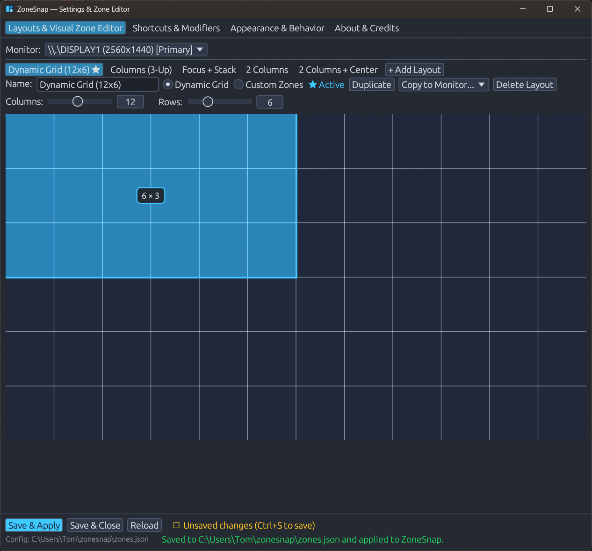
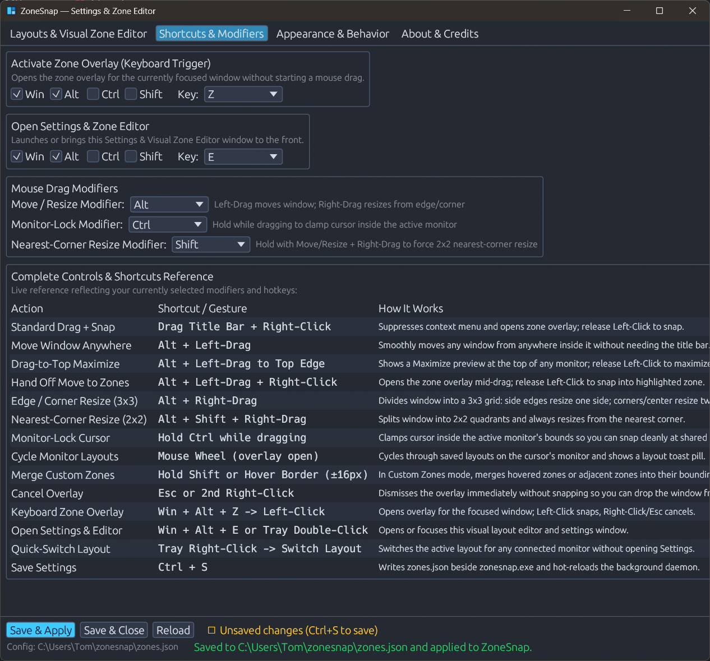
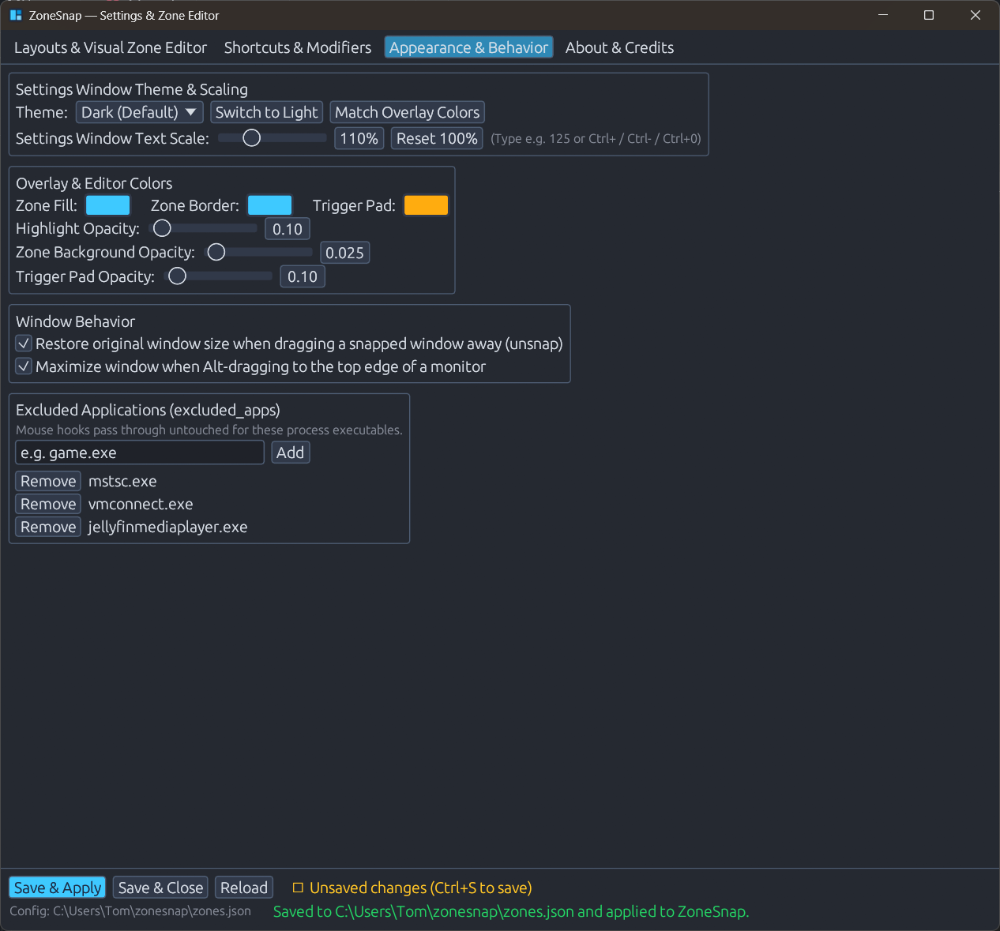

<div align="center">
  
  <h1>ZoneSnap</h1>
  <p>
    <strong>Lightweight, single-binary portable window snapping and window management for Windows 10 &amp; 11 — written in Rust.</strong>
  </p>

  <p>
    <a href="https://github.com/PlatyLord/zonesnap-rs/releases">
      
    </a>
    <a href="LICENSE">
      
    </a>
    
    
    
  </p>

  <p>
    <a href="#why-zonesnap">Why ZoneSnap?</a> &middot;
    <a href="#how-zonesnap-compares">Compare</a> &middot;
    <a href="#screenshots">Screenshots</a> &middot;
    <a href="#quick-start">Quick Start</a> &middot;
    <a href="#controls--shortcuts">Controls</a> &middot;
    <a href="#configuration-zonesjson">Configuration</a> &middot;
    <a href="#building-from-source">Building</a> &middot;
    <a href="CHANGELOG.md">Changelog</a>
  </p>

  <br />

  
  <p>
    <em>ZoneSnap overlay showing decoupled amber <strong>Custom Trigger Areas</strong> inside wider side-column snap targets.</em>
  </p>
</div>

> **Status & License:** Released as-is under the [GNU General Public License v3.0 (GPL-3.0)](LICENSE). This project is not actively maintained—forks and community improvements are welcome, provided derivative works remain open source under GPL-3.0.

---

## Why ZoneSnap?

- **True Single-File Portability:** One standalone `zonesnap.exe` (~3.2 MB) with zero installer, DLLs, registry writes, or `%APPDATA%` clutter—`zones.json` lives right beside the `.exe`.
- **~1–3 MB Idle RAM:** Sits near ~1 MB at startup and automatically evicts full-screen overlay buffers after 10 seconds of idle time.
- **Two Snapping Modes, Unlimited Layouts:** Switch live between **Dynamic Grid** (drag-to-span cells) and **Custom Zones** (with decoupled **Custom Trigger Areas**, `Shift` merge, and `±16px` border merge).
- **Keyboard or One-Handed Mouse Move & Resize:** Move from anywhere inside a window (`Alt + Left-Drag`) or resize from the nearest edge/corner (`Alt + Right-Drag`), or remap `Alt` to `Mouse Back` / `Mouse Forward` / `Middle Click` so you never have to touch the keyboard.
- **Flush Mixed-DPI Snapping & Monitor-Lock:** Second-pass `DWMWA_EXTENDED_FRAME_BOUNDS` compensation eliminates Windows 10/11 drop-shadow gaps, `Ctrl` clamps the cursor inside the active monitor (`ClipCursor`), and unsnapping restores the window's prior size.
- **10-Theme Visual Editor & System Tray:** Quick-switch layouts per monitor from the tray, or open the `egui` editor with Light, Dark, and Catppuccin themes plus DPI-friendly text scaling.

---

## How ZoneSnap Compares

| Feature | ZoneSnap | PowerToys FancyZones | WindowGrid | AltSnap | Windows 11 Snap |
| --- | :---: | :---: | :---: | :---: | :---: |
| **Single portable `.exe` (no install)** | ✅ | ❌ | ✅ | ✅ | Built-in |
| **Idle RAM** | ~1–3 MB | ~100–300+ MB | ~5–15 MB | ~2–5 MB | OS built-in |
| **Custom Zones** | ✅ | ✅ | ❌ | Partial | Fixed presets |
| **Dynamic Drag-to-Span Grid** | ✅ | ❌ | ✅ | ❌ | ❌ |
| **Decoupled Trigger vs. Snap Bounds** | ✅ | ❌ | ❌ | ❌ | ❌ |
| **Move & Edge/Corner Resize (`Alt` or Mouse Button)** | ✅ | ❌ | ❌ | ✅ | ❌ |
| **Scroll-Wheel Layout Cycling** | ✅ | ❌ | ❌ | ❌ | ❌ |
| **Ctrl Monitor-Lock (`ClipCursor`)** | ✅ | ❌ | ❌ | ❌ | ❌ |
| **Open Source & Free** | ✅ GPL-3.0 | ✅ MIT | ❌ Closed | ✅ GPL-3.0 | ❌ Proprietary |

---

## Screenshots

<table>
  <tr>
    <td width="50%" align="center">
      <br />
      <strong>Custom Zones &amp; Trigger Area Editor</strong><br />
      <sub>Draw/resize snap bounds and compact drop triggers.</sub>
    </td>
    <td width="50%" align="center">
      <br />
      <strong>Dynamic Grid Editor</strong><br />
      <sub>Configure per-monitor grids from 2&times;2 up to 24&times;16 with live preview.</sub>
    </td>
  </tr>
  <tr>
    <td width="50%" align="center">
      <br />
      <strong>Shortcuts &amp; Modifiers</strong><br />
      <sub>Customize hotkeys and drag modifiers alongside a live 14-row reference.</sub>
    </td>
    <td width="50%" align="center">
      <br />
      <strong>Themes, Scaling &amp; Behavior</strong><br />
      <sub>Light, Dark, and Catppuccin Mocha/Macchiato/Frappé/Latte themes plus text scaling.</sub>
    </td>
  </tr>
</table>

---

## Quick Start

1. **Download:** Grab `zonesnap.exe` from [Releases](https://github.com/PlatyLord/zonesnap-rs/releases) (see [CHANGELOG.md](CHANGELOG.md) for release notes).
2. **Run Anywhere:** Put `zonesnap.exe` in any folder (or USB drive) and double-click it—it runs silently in the system tray and creates `zones.json` beside the binary on first launch.
3. **Start Snapping:**
   - Drag any window title bar and tap **Right-Click** (while holding Left-Click) to open the zone overlay, move to a target, and release **Left-Click** to snap.
   - Or press **`Win + Alt + Z`** to snap the focused window with keyboard + click.

> **Tip:** Right-click the tray icon anytime to switch active layouts per monitor, open **Configure Zones & Settings** (or double-click the icon), reload `zones.json`, or exit.

---

## Controls & Shortcuts

| Action                              | Default Input                              | Notes                                                                                 |
| ----------------------------------- | ------------------------------------------ | ------------------------------------------------------------------------------------- |
| **Trigger Overlay During Drag**     | Drag title bar + tap `Right-Click`         | Suppresses context menu; release `Left-Click` to snap                                 |
| **Move Window Anywhere**            | `Alt + Left-Drag`                          | Remappable (`Alt`/`Ctrl`/`Shift`/`Win` or `Mouse Back`/`Mouse Forward`/`Middle Click`) |
| **Drag-to-Top Maximize**            | `Alt + Left-Drag` to monitor top edge      | Shows Maximize preview; release `Left-Click` to maximize                              |
| **Hand Off Move to Zones**          | Tap `Right-Click` during `Alt + Left-Drag` | Opens zone overlay mid-drag                                                           |
| **Resize from Nearest Edge/Corner** | `Alt + Right-Drag`                         | 3×3 window region detection                                                           |
| **Resize from Nearest Corner Only** | `Alt + Shift + Right-Drag`                 | 2×2 quadrant detection (configurable `corner_resize_modifier`)                        |
| **Lock Cursor to Active Monitor**   | Hold `Ctrl` while dragging                 | Clamps cursor inside active monitor (`ClipCursor`)                                    |
| **Cycle Layouts on Monitor**        | `Mouse Wheel` (overlay active)             | Updates layout live with toast badge                                                  |
| **Merge Custom Zones**              | Hold `Shift` or hover border (`±16px`)     | Combines hovered zones into bounding box                                              |
| **Cancel Overlay**                  | `Esc` or 2nd `Right-Click`                 | Dismisses overlay without snapping                                                    |
| **Keyboard Overlay Trigger**        | `Win + Alt + Z`                            | Opens overlay for focused window; `Left-Click` snaps                                  |
| **Open Settings & Zone Editor**     | `Win + Alt + E` or Tray Menu               | Launches visual editor (`--settings`)                                                 |
| **Save in Settings Editor**         | `Ctrl + S` or **Save & Apply**             | Writes `zones.json` and hot-reloads daemon                                            |

### Highlights & Workflow Notes

- **One-Handed Mouse-Button Modifier:** Remap `move_resize_modifier` to `Mouse Back`, `Mouse Forward`, or `Middle Click` in **Shortcuts & Modifiers** to hold that mouse button instead of `Alt` for Move, Resize, Top-Edge Maximize, and Overlay Hand-Off. Quick taps without dragging still fire your normal Back/Forward/Middle click on release.
- **Custom Trigger Areas & Merging:** In Custom Zones mode, assign a compact **Trigger** pad separate from a zone's full **Snap Output** bounds (ideal for a small Center Focus drop pad over side columns), with customizable colors and opacities. Hover within `16px` of a shared border to auto-merge adjacent zones, or hold `Shift` across multiple zones.
- **Dynamic Grid & Scroll Cycling:** Dynamic Grid (`2×2` up to `24×16`, default `12×6`) anchors at your starting cell and spans to the current cell. Scroll the mouse wheel while the overlay is open to cycle layouts on that monitor.
- **Mixed-DPI, Taskbar Safety & Unsnap Restore:** Monitor profiles key by `<device_name>_<width>x<height>` and snap inside `rcWork` (never covering the taskbar), with a second-pass `DWMWA_EXTENDED_FRAME_BOUNDS` adjustment across DPI boundaries and automatic pre-snap size restoration when dragging a window away.
- **Visual Editor Tabs:** Manage per-monitor layouts (Add, Duplicate, Copy to Monitor, Presets, Split V/H, Custom Trigger toggle), rebind hotkeys/modifiers alongside a live reference table, choose from **10 themes** (`Dark`, `Light`, `Catppuccin Mocha/Macchiato/Frappé/Latte`, `Nord`, `Tokyo Night`, `Gruvbox Dark`, `Solarized Light`) with **Match Overlay Colors** and text scaling (`85%–175%`), and maintain `excluded_apps`.

---

## Configuration (`zones.json`)

`zones.json` is stored in the exact same directory as `zonesnap.exe` and hot-reloads automatically on save.

<details>
<summary>View example <code>zones.json</code></summary>

```json
{
  "version": 1,
  "appearance": {
    "highlight_color": [56, 189, 248],
    "highlight_opacity": 0.35,
    "border_color": [56, 189, 248],
    "zone_bg_opacity": 0.14,
    "trigger_color": [245, 158, 11],
    "trigger_opacity": 0.25,
    "gui_scale": 1.0,
    "gui_theme": "dark"
  },
  "behavior": {
    "restore_on_unsnap": true,
    "drag_top_maximize": true,
    "excluded_apps": ["mstsc.exe", "vmconnect.exe"]
  },
  "hotkeys": {
    "activate_overlay": { "modifiers": ["Win", "Alt"], "key": "Z" },
    "open_settings": { "modifiers": ["Win", "Alt"], "key": "E" },
    "move_resize_modifier": "Alt",
    "monitor_lock_modifier": "Ctrl",
    "corner_resize_modifier": "Shift"
  },
  "monitors": {
    "\\\\.\\DISPLAY1_2560x1440": {
      "device_name": "\\\\.\\DISPLAY1",
      "width": 2560,
      "height": 1440,
      "active_layout_index": 0,
      "layouts": [
        {
          "name": "Dynamic Grid (12x6)",
          "mode": { "type": "dynamic_grid", "cols": 12, "rows": 6 }
        },
        {
          "name": "Columns (3-Up)",
          "mode": {
            "type": "custom_zones",
            "zones": [
              [0.0, 0.0, 0.5, 1.0],
              [0.5, 0.0, 1.0, 1.0],
              {
                "bounds": [0.15, 0.0, 0.85, 1.0],
                "trigger": [0.42, 0.25, 0.58, 0.75]
              }
            ]
          }
        }
      ]
    }
  }
}
```

</details>

<details>
<summary>View full Field Reference</summary>

| Section      | Field                    | Default                          | Description                                                                                                                                      |
| ------------ | ------------------------ | -------------------------------- | ------------------------------------------------------------------------------------------------------------------------------------------------ |
| `appearance` | `highlight_color`        | `[56, 189, 248]`                 | RGB fill color of active/hovered zones                                                                                                           |
| `appearance` | `highlight_opacity`      | `0.35`                           | Opacity of active zone fill (`0.05`–`0.85`)                                                                                                      |
| `appearance` | `border_color`           | `[56, 189, 248]`                 | RGB border color of active zone outline                                                                                                          |
| `appearance` | `zone_bg_opacity`        | `0.14`                           | Opacity of inactive custom zone cards (`0.0`–`0.50`)                                                                                             |
| `appearance` | `trigger_color`          | `[245, 158, 11]`                 | RGB color of decoupled Custom Trigger drop pads                                                                                                  |
| `appearance` | `trigger_opacity`        | `0.25`                           | Opacity of Custom Trigger pad fill (`0.05`–`0.85`)                                                                                               |
| `appearance` | `gui_scale`              | `1.0`                            | Settings GUI text/UI scale multiplier (`0.85`–`1.75`, on top of Windows DPI scaling)                                                             |
| `appearance` | `gui_theme`              | `"dark"`                         | Settings GUI theme (`dark`, `light`, `catppuccin_mocha`/`macchiato`/`frappe`/`latte`, `nord`, `tokyo_night`, `gruvbox_dark`, `solarized_light`)  |
| `behavior`   | `restore_on_unsnap`      | `true`                           | Restore original window size when dragged away                                                                                                   |
| `behavior`   | `drag_top_maximize`      | `true`                           | Maximize window when Move + Left-Drag reaches the top edge of a monitor                                                                          |
| `behavior`   | `excluded_apps`          | `["mstsc.exe", "vmconnect.exe"]` | Lowercase executable names where mouse hooks pass through untouched                                                                              |
| `hotkeys`    | `activate_overlay`       | `Win+Alt+Z`                      | Global hotkey to open overlay for focused window                                                                                                 |
| `hotkeys`    | `open_settings`          | `Win+Alt+E`                      | Global hotkey to open Settings & Zone Editor                                                                                                     |
| `hotkeys`    | `move_resize_modifier`   | `"Alt"`                          | Modifier for Move & Resize (`Alt`, `Ctrl`, `Shift`, `Win`, `Mouse Back`, `Mouse Forward`, `Middle Click`)                                        |
| `hotkeys`    | `monitor_lock_modifier`  | `"Ctrl"`                         | Modifier to clamp cursor to monitor (`Ctrl`, `Shift`, `Alt`, `Win`)                                                                              |
| `hotkeys`    | `corner_resize_modifier` | `"Shift"`                        | Extra modifier held during Move/Resize + `Right-Drag` to force nearest-corner resize (`Shift`, `Ctrl`, `Alt`, `Win`, `Disabled`)                 |
| `monitors`   | `active_layout_index`    | `0`                              | 0-based index of the active layout for that monitor                                                                                              |
| `monitors`   | `layouts`                | 3 starter layouts                | List of `dynamic_grid` (`cols`, `rows`) or `custom_zones` (`[x1, y1, x2, y2]` or `{ bounds, trigger }`)                                          |

Supported hotkey `key` values: `A`–`Z`, `0`–`9`, `F1`–`F12`, `Space`, `Tab`, `Enter`, `Escape`, `Left`, `Right`, `Up`, `Down`.

</details>

---

## Troubleshooting & FAQ

- **An elevated (Run as Administrator) window won't snap or move:** Windows UIPI blocks non-elevated hooks from moving elevated windows. Run `zonesnap.exe` as Administrator if you need to manage elevated windows.
- **Remote Desktop or a fullscreen game intercepts clicks:** Add its process filename (e.g. `mstsc.exe`, `game.exe`) under **Appearance & Behavior → Excluded Applications** (`excluded_apps`).
- **Windows SmartScreen warns on an unsigned `.exe`:** ZoneSnap is distributed without a paid code-signing certificate. You can verify your downloaded binary against the `sha256` digest shown next to `zonesnap.exe` on the GitHub Release page:
  ```powershell
  Get-FileHash -Algorithm SHA256 .\zonesnap.exe
  ```
- **Where are my settings stored?** Always in `zones.json` in the exact same directory as `zonesnap.exe`.

---

## Building from Source

Requires the Rust toolchain (`x86_64-pc-windows-msvc`) and Visual Studio C++ Build Tools:

```powershell
cargo test
cargo build --release
```

The standalone GUI executable is written to `target\release\zonesnap.exe` (statically linking the MSVC CRT via `.cargo/config.toml`). Pushing a version tag (e.g. `v1.2.0`) triggers [`.github/workflows/release.yml`](.github/workflows/release.yml) to run `cargo test`, build `zonesnap.exe`, extract release notes from [CHANGELOG.md](CHANGELOG.md), and publish a GitHub Release automatically.

---

## Credits & License

- **Author:** Tom (`PlatyLord`)
- **Co-Built With:** Antigravity (Google DeepMind)
- **Hero Screenshot Wallpaper:** ["Pigeon Council" (Nº 70)](https://wallhalla.com/wallpaper/df43ad5f-380b-4f00-b2a8-b50f545699d8) from [Wallhalla](https://wallhalla.com) (AI Hybrid, used under [Wallhalla's Free terms](https://wallhalla.com/terms); excluded from the project's GPL-3.0 license).
- **License:** [GNU General Public License v3.0 (GPL-3.0)](LICENSE) — free to use, modify, and fork; derivative works must remain open source under GPL-3.0. Provided as-is with no warranty or active maintenance.
