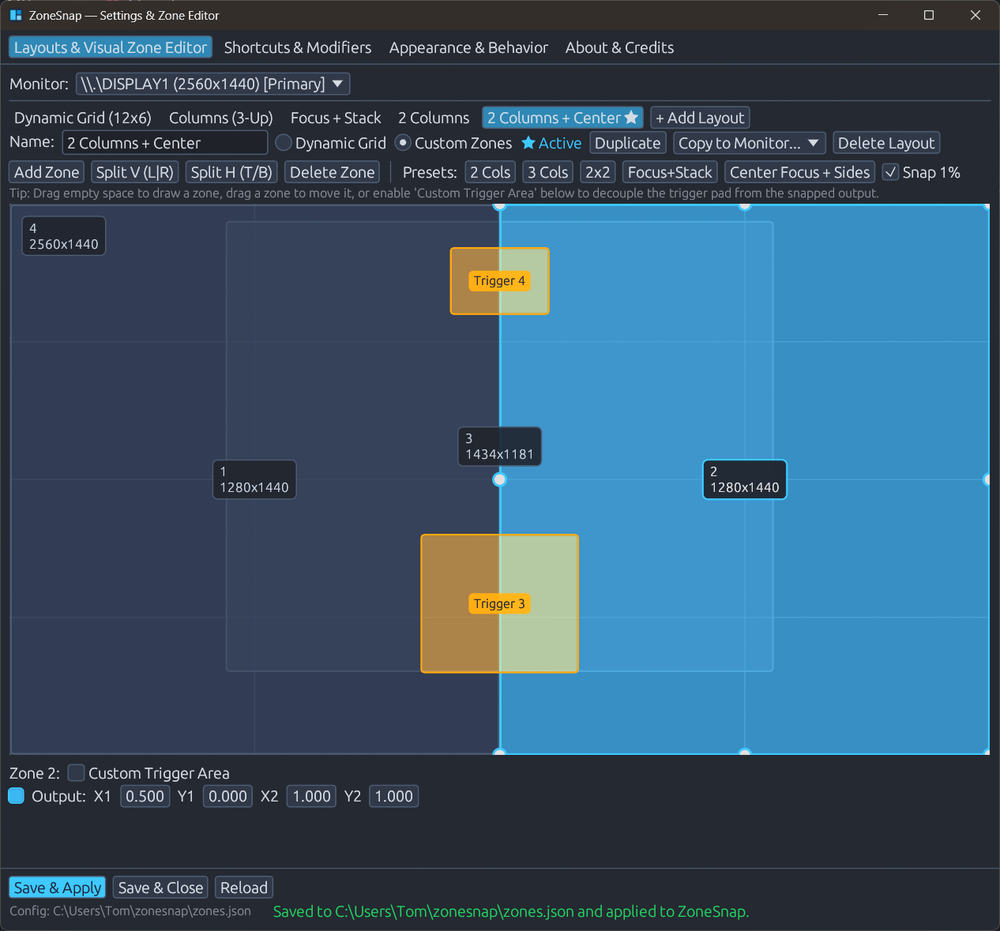

<div align="center">
  
  <h1>ZoneSnap</h1>
  <p>
    <strong>A lightweight, portable window snapper and window manager for Windows 10 &amp; 11 — built in Rust.</strong>
  </p>

  <p>
    <a href="https://github.com/PlatyLord/zonesnap-rs/releases">
      
    </a>
    <a href="LICENSE">
      
    </a>
    
    
    
  </p>

  <p>
    <a href="#why-zonesnap">Why ZoneSnap?</a> &middot;
    <a href="#how-zonesnap-compares">Compare</a> &middot;
    <a href="#screenshots">Screenshots</a> &middot;
    <a href="#quick-start">Quick Start</a> &middot;
    <a href="#controls--shortcuts">Controls</a> &middot;
    <a href="#troubleshooting--faq">FAQ</a> &middot;
    <a href="#technical-details--configuration">Technical &amp; Config</a> &middot;
    <a href="CHANGELOG.md">Changelog</a>
  </p>

  <br />

  
  <p>
    <em>Drop a window onto one of the smaller amber <strong>Custom Trigger Areas</strong> to snap it into a larger overlapping zone.</em>
  </p>
</div>

> **Note, Status & License:** Built with AI assistance (Antigravity) and released as-is under the [GNU General Public License v3.0 (GPL-3.0)](LICENSE). This project is not actively maintained—forks and community improvements are welcome, as long as derivative works stay open source under GPL-3.0.

---

## Why ZoneSnap?

Windows already has basic window snapping, and tools like PowerToys FancyZones add custom layouts, so why use this instead?

- **Just one file, no install:** Download `zonesnap.exe` (~4 MB) and run it from any folder or even a USB stick. Your settings live in a single `zones.json` file right next to it, so it won't scatter files across your PC or leave junk behind if you delete it.
- **Barely uses any RAM:** While sitting in the background, it uses around 1–3 MB of memory (compared to hundreds of MB for bigger suites like PowerToys), so you won't feel it running.
- **Two ways to snap windows:** Use **Dynamic Grid** to drag across a grid and size a window on the spot, or **Custom Zones** to build your own reusable layouts. You can also merge zones by holding `Shift` (or hovering over a shared border), or put smaller drop targets inside bigger zones when layouts overlap.
- **Move and resize from anywhere:** Hold `Alt` and left-drag anywhere inside a window to move it, or right-drag to resize from the nearest edge or corner. Don't want to touch the keyboard? Swap `Alt` for a spare mouse button (`Back`, `Forward`, or `Middle Click`) and do it all one-handed.
- **Lines up cleanly across multiple screens:** Windows sit flush edge-to-edge without the weird invisible border gaps Windows 10 and 11 usually leave behind, even if your monitors have different sizes or zoom levels. Hold `Ctrl` while dragging to stop your mouse slipping onto another screen, and pull a snapped window away to restore its old size.
- **Easier-to-grab window edges (optional):** If you're sick of trying to click the thin edges of Windows 11 windows, you can turn on wider invisible resize borders around your active window, with optional circular grab handles. It's turned off by default so it doesn't use extra resources unless you want it.
- **Built-in visual editor:** Switch layouts for each monitor from the system tray, or open the settings window to draw zones visually, change shortcuts, adjust text size, and pick from 10 light and dark themes.

---

## How ZoneSnap Compares

| Feature                                            | ZoneSnap | PowerToys FancyZones | WindowGrid | AltSnap | Windows 11 Snap |
| -------------------------------------------------- | :------: | :------------------: | :--------: | :-----: | :-------------: |
| **Single portable `.exe` (no install)**            |    ✅    |          ❌          |     ✅     |   ✅    |    Built-in     |
| **Idle RAM**                                       | ~1–3 MB  |     ~100–300+ MB     |  ~5–15 MB  | ~2–5 MB |   OS built-in   |
| **Custom Zones**                                   |    ✅    |          ✅          |     ❌     | Partial |  Fixed presets  |
| **Drag-to-Span Grid**                              |    ✅    |          ❌          |     ✅     |   ❌    |       ❌        |
| **Separate Drop Target & Snap Size**               |    ✅    |          ❌          |     ❌     |   ❌    |       ❌        |
| **Move & Resize Anywhere (`Alt` or Mouse Button)** |    ✅    |          ❌          |     ❌     |   ✅    |       ❌        |
| **Wider Resize Borders & Grab Handles (optional)** |    ✅    |          ❌          |     ❌     |   ❌    |       ❌        |
| **Scroll-Wheel Layout Cycling**                    |    ✅    |          ❌          |     ❌     |   ❌    |       ❌        |
| **Lock Cursor to One Monitor (`Ctrl`)**            |    ✅    |          ❌          |     ❌     |   ❌    |       ❌        |
| **Open Source & Free**                             | GPL-3.0  |         MIT          |   Closed   | GPL-3.0 |   Proprietary   |

---

## Screenshots

<table>
  <tr>
    <td width="50%" align="center">
      <br />
      <strong>Custom Zones &amp; Trigger Area Editor</strong><br />
      <sub>Draw zones and optional smaller drop pads visually.</sub>
    </td>
    <td width="50%" align="center">
      <br />
      <strong>Dynamic Grid Editor</strong><br />
      <sub>Set up per-monitor grids from 2&times;2 up to 24&times;16 with a live preview.</sub>
    </td>
  </tr>
  <tr>
    <td width="50%" align="center">
      <br />
      <strong>Shortcuts &amp; Modifiers</strong><br />
      <sub>Change hotkeys and drag keys alongside a built-in cheat sheet.</sub>
    </td>
    <td width="50%" align="center">
      <br />
      <strong>Themes, Scaling &amp; Behavior</strong><br />
      <sub>Pick from 10 light and dark themes, tweak overlay colors, and scale text size.</sub>
    </td>
  </tr>
</table>

---

## Quick Start

1. **Download:** Grab `zonesnap.exe` from [Releases](https://github.com/PlatyLord/zonesnap-rs/releases) (see [CHANGELOG.md](CHANGELOG.md) for what's new).
2. **Run it anywhere:** Put `zonesnap.exe` in any folder (or on a USB drive) and double-click it. It runs quietly in your system tray and creates `zones.json` in the same folder on first launch.
3. **Start snapping:**
   - Drag any window's title bar and tap **Right-Click** (while still holding Left-Click) to show the zone overlay, move over a zone, and let go of **Left-Click** to snap.
   - Or press **`Win + Alt + Z`** to open the overlay for your current window, then click a zone.

> **Tip:** Right-click the tray icon anytime to switch layouts per monitor, open **Configure Zones & Settings** (or double-click the icon), reload `zones.json`, or exit.

---

## Controls & Shortcuts

| Action                              | Default Input                              | Notes                                                                           |
| ----------------------------------- | ------------------------------------------ | ------------------------------------------------------------------------------- |
| **Show Overlay While Dragging**     | Drag title bar + tap `Right-Click`         | Release `Left-Click` to snap (won't pop up the right-click menu)                |
| **Move Window Anywhere**            | `Alt + Left-Drag`                          | Swap `Alt` for `Ctrl`, `Shift`, `Win`, or `Mouse Back`/`Forward`/`Middle Click` |
| **Drag-to-Top Maximize**            | `Alt + Left-Drag` to top edge              | Shows a Maximize preview; release `Left-Click` to maximize                      |
| **Switch Move to Zone Snapping**    | Tap `Right-Click` during `Alt + Left-Drag` | Opens the zone overlay mid-drag                                                 |
| **Resize from Nearest Edge/Corner** | `Alt + Right-Drag`                         | Grabs whichever edge or corner is closest to your cursor                        |
| **Resize from Nearest Corner Only** | `Alt + Shift + Right-Drag`                 | Always resizes from the closest corner (`Shift` can be changed)                 |
| **Lock Cursor to Active Monitor**   | Hold `Ctrl` while dragging                 | Stops your mouse from slipping onto another screen                              |
| **Switch Layouts on Monitor**       | `Mouse Wheel` (overlay open)               | Cycles layouts live with a small on-screen label                                |
| **Merge Custom Zones**              | Hold `Shift` or hover a shared border      | Combines zones into one larger area                                             |
| **Cancel Overlay**                  | `Esc` or a 2nd `Right-Click`               | Closes the overlay without moving the window                                    |
| **Keyboard Overlay Trigger**        | `Win + Alt + Z`                            | Opens overlay for the active window; `Left-Click` snaps                         |
| **Open Settings & Zone Editor**     | `Win + Alt + E` or Tray Icon               | Opens the visual editor and settings window                                     |
| **Save in Settings Editor**         | `Ctrl + S` or **Save & Apply**             | Saves `zones.json` and applies changes immediately                              |

<details>
<summary><strong>More Tips &amp; Feature Details</strong></summary>

- **One-handed mouse controls:** In **Shortcuts & Modifiers**, change `move_resize_modifier` to `Mouse Back`, `Mouse Forward`, or `Middle Click` so you can hold a mouse button instead of `Alt` to move, resize, maximize at the top edge, or trigger zones. Quick clicks without dragging still work normally as Back/Forward/Middle click.
- **Wider resize borders & grab handles:** Turn on **Expanded Resize Borders** under **Appearance & Behavior** to add a wider invisible grab area around the outside of your active window (or corners only), plus an optional floating circular grab handle with custom size and color.
- **Custom Trigger Areas & zone merging:** In Custom Zones mode, you can give a zone a smaller **Trigger** drop pad separate from its full snap area—great for putting a small Center Focus drop pad on top of side columns. Hover within `16px` of a shared border to auto-merge neighbouring zones, or hold `Shift` across multiple zones.
- **Dynamic Grid & scroll cycling:** Dynamic Grid (`2×2` up to `24×16`, default `12×6`) starts at the cell where you opened the overlay and stretches to wherever you move your mouse. Scroll the mouse wheel while the overlay is up to cycle through layouts on that monitor.
- **Visual editor & themes:** Manage layouts per monitor (Add, Duplicate, Copy to Monitor, Presets, Split V/H, Custom Trigger toggle), pick from **10 themes** (`Dark`, `Light`, `Catppuccin Mocha/Macchiato/Frappé/Latte`, `Nord`, `Tokyo Night`, `Gruvbox Dark`, `Solarized Light`), click **Match Overlay Colors** to sync your overlay with your theme, and scale the editor's text from `85%` to `175%`.

</details>

---

## Troubleshooting & FAQ

- **A window run as Administrator won't snap or move:** Windows blocks normal apps from moving programs that were started as Administrator. If you need to snap Admin windows, run `zonesnap.exe` as Administrator too.
- **Remote Desktop or a fullscreen game acts weird with clicks:** Add its `.exe` filename (like `mstsc.exe` or `game.exe`) under **Appearance & Behavior → Excluded Applications** so ZoneSnap ignores it.
- **Windows SmartScreen warns that the `.exe` is unrecognized:** ZoneSnap is free and open source, so it isn't signed with a paid code-signing certificate. You can double-check your download against the `sha256` hash listed next to `zonesnap.exe` on the GitHub Release page:
  ```powershell
  Get-FileHash -Algorithm SHA256 .\zonesnap.exe
  ```
- **Where are my settings saved?** Always in `zones.json`, in the same folder as `zonesnap.exe`.

---

## Technical Details & Configuration

Most people never need to touch any of this—the visual Settings window handles layouts, shortcuts, themes, and behavior automatically. Expand any section below if you want to see how ZoneSnap works under the hood, edit `zones.json` by hand, or compile it yourself.

<details>
<summary><strong>Under the Hood (Performance &amp; Windows Internals)</strong></summary>

- **Zero-dependency single executable:** Statically links the MSVC CRT via `.cargo/config.toml` and uses `#![windows_subsystem = "windows"]` so no console window flashes and no external DLLs, installer, registry entries, or `%APPDATA%` folders are created.
- **~1–3 MB idle RAM:** Starts near ~1 MB and automatically evicts full-screen layered GDI overlay buffers and cached text scratch surfaces after 10 seconds of idle time.
- **Separate Settings GUI process:** Opening Settings spawns `zonesnap.exe --settings` using `egui` / `eframe`. Closing the editor exits that subprocess completely, freeing all UI/GPU memory; clicking **Save & Apply** writes `zones.json` and sends a reload signal to the background daemon.
- **Mixed-DPI & flush snapping:** Runs with `DPI_AWARENESS_CONTEXT_PER_MONITOR_AWARE_V2`, snaps strictly inside each monitor's `rcWork` (never overlapping the taskbar), performs a second-pass `DWMWA_EXTENDED_FRAME_BOUNDS` adjustment across DPI boundaries to eliminate Windows 10/11 drop-shadow gaps, clamps the cursor with `ClipCursor` when holding `Ctrl`, and keys monitor profiles by `<device_name>_<width>x<height>`.
- **Smooth resizing & responsive hooks:** The low-level hook thread (`WH_MOUSE_LL`) runs at `THREAD_PRIORITY_HIGHEST`, avoids process queries on ordinary clicks, queries real `WM_GETMINMAXINFO` limits with a non-blocking timeout (plus `IsHungAppWindow` guards), and paces resize updates with a final settle pass on mouse-up.
- **Zero-overhead opt-in resize borders:** When `edge_resize.enabled` is `false`, ZoneSnap registers zero `SetWinEventHook` listeners, allocates zero GDI handles, and bails out with a single atomic check in the mouse hook. When enabled, it uses `SetWinEventHook` with integer bounding-ring math, UIPI checks, and occlusion guards so neighbouring windows stay interactive.

</details>

<details>
<summary><strong>Example <code>zones.json</code></strong></summary>

`zones.json` lives in the same folder as `zonesnap.exe` and hot-reloads automatically when saved.

```json
{
  "version": 1,
  "appearance": {
    "highlight_color": [56, 189, 248],
    "highlight_opacity": 0.35,
    "border_color": [56, 189, 248],
    "zone_bg_opacity": 0.14,
    "trigger_color": [245, 158, 11],
    "trigger_opacity": 0.25,
    "gui_scale": 1.0,
    "gui_theme": "dark"
  },
  "behavior": {
    "restore_on_unsnap": true,
    "drag_top_maximize": true,
    "excluded_apps": ["mstsc.exe", "vmconnect.exe"]
  },
  "hotkeys": {
    "activate_overlay": { "modifiers": ["Win", "Alt"], "key": "Z" },
    "open_settings": { "modifiers": ["Win", "Alt"], "key": "E" },
    "move_resize_modifier": "Alt",
    "monitor_lock_modifier": "Ctrl",
    "corner_resize_modifier": "Shift"
  },
  "edge_resize": {
    "enabled": false,
    "grab_padding_px": 10,
    "corners_only": false,
    "show_handles": true,
    "handle_size_px": 20,
    "handle_color": [56, 189, 248]
  },
  "monitors": {
    "\\\\.\\DISPLAY1_2560x1440": {
      "device_name": "\\\\.\\DISPLAY1",
      "width": 2560,
      "height": 1440,
      "active_layout_index": 0,
      "layouts": [
        {
          "name": "Dynamic Grid (12x6)",
          "mode": { "type": "dynamic_grid", "cols": 12, "rows": 6 }
        },
        {
          "name": "Columns (3-Up)",
          "mode": {
            "type": "custom_zones",
            "zones": [
              [0.0, 0.0, 0.5, 1.0],
              [0.5, 0.0, 1.0, 1.0],
              {
                "bounds": [0.15, 0.0, 0.85, 1.0],
                "trigger": [0.42, 0.25, 0.58, 0.75]
              }
            ]
          }
        }
      ]
    }
  }
}
```

</details>

<details>
<summary><strong>Full <code>zones.json</code> Field Reference</strong></summary>

| Section       | Field                    | Default                          | Description                                                                                                                                     |
| ------------- | ------------------------ | -------------------------------- | ----------------------------------------------------------------------------------------------------------------------------------------------- |
| `appearance`  | `highlight_color`        | `[56, 189, 248]`                 | RGB fill color of active/hovered zones                                                                                                          |
| `appearance`  | `highlight_opacity`      | `0.35`                           | Opacity of active zone fill (`0.05`–`0.85`)                                                                                                     |
| `appearance`  | `border_color`           | `[56, 189, 248]`                 | RGB border color of active zone outline                                                                                                         |
| `appearance`  | `zone_bg_opacity`        | `0.14`                           | Opacity of inactive custom zone cards (`0.0`–`0.50`)                                                                                            |
| `appearance`  | `trigger_color`          | `[245, 158, 11]`                 | RGB color of Custom Trigger drop pads                                                                                                           |
| `appearance`  | `trigger_opacity`        | `0.25`                           | Opacity of Custom Trigger pad fill (`0.05`–`0.85`)                                                                                              |
| `appearance`  | `gui_scale`              | `1.0`                            | Settings GUI text/UI scale multiplier (`0.85`–`1.75`, on top of Windows DPI scaling)                                                            |
| `appearance`  | `gui_theme`              | `"dark"`                         | Settings GUI theme (`dark`, `light`, `catppuccin_mocha`/`macchiato`/`frappe`/`latte`, `nord`, `tokyo_night`, `gruvbox_dark`, `solarized_light`) |
| `behavior`    | `restore_on_unsnap`      | `true`                           | Restore original window size when dragged away                                                                                                  |
| `behavior`    | `drag_top_maximize`      | `true`                           | Maximize window when Move + Left-Drag reaches the top edge of a monitor                                                                         |
| `behavior`    | `excluded_apps`          | `["mstsc.exe", "vmconnect.exe"]` | Lowercase executable names where mouse hooks pass through untouched                                                                             |
| `hotkeys`     | `activate_overlay`       | `Win+Alt+Z`                      | Global hotkey to open overlay for focused window                                                                                                |
| `hotkeys`     | `open_settings`          | `Win+Alt+E`                      | Global hotkey to open Settings & Zone Editor                                                                                                    |
| `hotkeys`     | `move_resize_modifier`   | `"Alt"`                          | Modifier for Move & Resize (`Alt`, `Ctrl`, `Shift`, `Win`, `Mouse Back`, `Mouse Forward`, `Middle Click`)                                       |
| `hotkeys`     | `monitor_lock_modifier`  | `"Ctrl"`                         | Modifier to clamp cursor to monitor (`Ctrl`, `Shift`, `Alt`, `Win`)                                                                             |
| `hotkeys`     | `corner_resize_modifier` | `"Shift"`                        | Extra modifier held during Move/Resize + `Right-Drag` to force nearest-corner resize (`Shift`, `Ctrl`, `Alt`, `Win`, `Disabled`)                |
| `edge_resize` | `enabled`                | `false`                          | Enable outward-expanded resize hit-boxes around the foreground window (zero hooks/overhead when `false`)                                        |
| `edge_resize` | `grab_padding_px`        | `10`                             | Outward grab ring thickness outside the window's visible DWM bounds in logical pixels (`4`–`32`)                                                |
| `edge_resize` | `corners_only`           | `false`                          | Restrict expanded resize hit-boxes and handles to the four corners (`true`) or allow all 8 edges and corners (`false`)                          |
| `edge_resize` | `show_handles`           | `true`                           | Show a floating circular visual grab handle when hovering an eligible expanded edge/corner                                                      |
| `edge_resize` | `handle_size_px`         | `20`                             | Diameter of the floating circular grab handle in logical pixels (`12`–`36`)                                                                     |
| `edge_resize` | `handle_color`           | `[56, 189, 248]`                 | RGB color `[R, G, B]` of the floating grab handle (synced via hex picker or **Match Overlay Colors** in **Appearance & Behavior**)              |
| `monitors`    | `active_layout_index`    | `0`                              | 0-based index of the active layout for that monitor                                                                                             |
| `monitors`    | `layouts`                | 3 starter layouts                | List of `dynamic_grid` (`cols`, `rows`) or `custom_zones` (`[x1, y1, x2, y2]` or `{ bounds, trigger }`)                                         |

Supported hotkey `key` values: `A`–`Z`, `0`–`9`, `F1`–`F12`, `Space`, `Tab`, `Enter`, `Escape`, `Left`, `Right`, `Up`, `Down`.

</details>

<details>
<summary><strong>Building from Source (Rust)</strong></summary>

Requires the Rust toolchain (`x86_64-pc-windows-msvc`) and Visual Studio C++ Build Tools:

```powershell
cargo test
cargo build --release
```

The standalone GUI executable is written to `target\release\zonesnap.exe` (statically linking the MSVC CRT via `.cargo/config.toml`). Pushing a version tag (e.g. `v1.3.0`) triggers [`.github/workflows/release.yml`](.github/workflows/release.yml) to run `cargo test`, build `zonesnap.exe`, extract release notes from [CHANGELOG.md](CHANGELOG.md), and publish a GitHub Release automatically.

</details>

---

## Credits & License

- **Author:** Tom (`PlatyLord`)
- **Co-Built With:** Antigravity (Google DeepMind)
- **Hero Screenshot Wallpaper:** ["Pigeon Council" (Nº 70)](https://wallhalla.com/wallpaper/df43ad5f-380b-4f00-b2a8-b50f545699d8) from [Wallhalla](https://wallhalla.com) (AI Hybrid, used under [Wallhalla's Free terms](https://wallhalla.com/terms); excluded from the project's GPL-3.0 license).
- **License:** [GNU General Public License v3.0 (GPL-3.0)](LICENSE) — free to use, modify, and fork; derivative works must remain open source under GPL-3.0. Provided as-is with no warranty or active maintenance.
